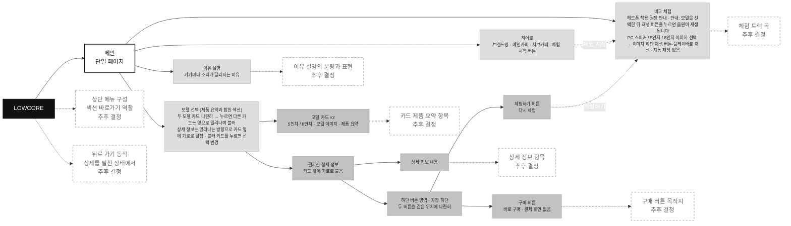

# LOWCORE 사이트 맵

- 기준 문서: 01-site-purpose.md, 02-site-structure.md
- 이 문서는 두 문서에 있는 내용만 담습니다.
- 단일 페이지(원페이지) 구성입니다.

---

## 1. Figma

| 항목 | 내용 |
|---|---|
| 파일 | https://www.figma.com/design/PCKvGX1rVF93q6g0Yz2cdP/LowCore?node-id=0-1 |
| 페이지 이름 | Site Map |
| 프레임 이름 | LOWCORE Site Map |
| 프레임 링크 | https://www.figma.com/design/PCKvGX1rVF93q6g0Yz2cdP/LowCore?node-id=7-3 |

Figma에서는 버튼으로 이동하는 곳을 점선 화살표 대신 박스 안에 `→`로 표기했습니다. 아래 Mermaid 계층도에서는 점선 화살표로 그렸습니다.

## 2. 표기 규칙

| 모양 | 뜻 |
|---|---|
| 흰색 실선 박스 | 페이지 |
| 연회색 작은 박스 | 페이지 안의 섹션 |
| 조금 더 진한 회색 박스 | 섹션 안 요소 |
| 점선 박스 | 추후 결정 |
| 실선 연결 | 계층 (사이트 → 페이지 → 섹션 → 섹션 안 요소) |
| 점선 연결 | 추후 결정 항목 |
| 점선 화살표 (Mermaid) / `→` (Figma) | 버튼으로 이동 |

## 3. 가로 계층도



## 4. 텍스트 계층도

```
LOWCORE
├── [페이지] 메인 (단일 페이지)
│   ├── [섹션] 히어로 ─ 체험 시작 ─▶ 비교 체험
│   ├── [섹션] 비교 체험
│   │   └── ┆ 체험 트랙 곡 ┆ 추후 결정
│   ├── [섹션] 이유 설명
│   │   └── ┆ 분량과 표현 ┆ 추후 결정
│   └── [섹션] 모델 선택 (제품 요약과 합친 섹션)
│       │   두 모델 카드 나란히 → 누르면 다른 카드는 옆으로 밀려나며 블러
│       │   상세 정보는 밀려나는 방향으로 카드 옆에 가로로 펼침 → 블러 카드를 누르면 선택 변경
│       ├── [요소] 모델 카드 ×2 (5인치 / 8인치 · 모델 이미지 · 제품 요약)
│       │   └── ┆ 카드 제품 요약 항목 ┆ 추후 결정
│       └── [요소] 펼쳐진 상세 정보 (카드 옆에 가로로 붙음)
│           ├── [요소] 상세 정보 내용
│           │   └── ┆ 상세 정보 항목 ┆ 추후 결정
│           └── [요소] 하단 버튼 영역 · 가장 하단 (두 버튼 나란히)
│               ├── [요소] 구매 버튼 (바로 구매 · 결제 화면 없음)
│               │   └── ┆ 구매 버튼 목적지 ┆ 추후 결정
│               └── [요소] 체험하기 버튼 ─▶ 메인 › 비교 체험
├── ┆ 상단 메뉴 구성 (섹션 바로가기 역할) ┆ 추후 결정
└── ┆ 상세를 펼친 상태에서 뒤로 가기 동작 ┆ 추후 결정
```

## 5. 추후 결정

| 항목 | 연결 위치 |
|---|---|
| 상단 메뉴 구성 (단일 페이지라 섹션 바로가기 역할) | 사이트 전체 |
| 상세를 펼친 상태에서 뒤로 가기 동작 | 사이트 전체 · 모델 선택 |
| 체험 트랙 곡 | 메인 › 비교 체험 |
| 이유 설명의 분량과 표현 방식 | 메인 › 이유 설명 |
| 카드의 제품 요약 항목 | 메인 › 모델 선택 › 모델 카드 |
| 펼쳐진 상세 정보 항목 | 메인 › 모델 선택 › 펼쳐진 상세 정보 |
| 구매 버튼을 눌렀을 때 가는 곳 | 메인 › 모델 선택 › 펼쳐진 상세 정보 › 하단 버튼 영역 › 구매 버튼 |
| 모바일 반응형에서 바뀌는 배치 | 사이트 전체 (사이트 맵에는 그리지 않음) |
